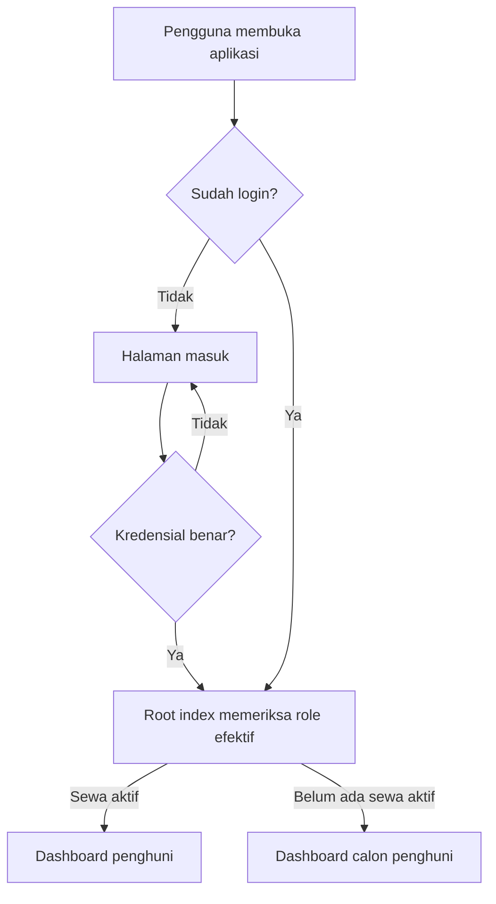
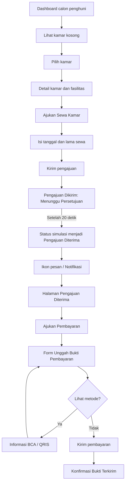

# Dokumentasi Alur dan Pengembangan SIMKOS

Dokumen ini menjelaskan struktur dan alur yang saat ini ada di proyek SIMKOS agar anggota kelompok, dosen, atau pengembang berikutnya dapat melanjutkan pekerjaan dengan konteks yang sama.

> **Penting:** aplikasi masih memiliki bagian simulasi. Pengajuan sewa calon penghuni dan notifikasinya disimpan di `$_SESSION`, belum di tabel database, dan belum terhubung ke tindakan admin.

## 1. Gambaran sistem

SIMKOS adalah aplikasi PHP dengan PostgreSQL. Pengguna masuk menggunakan email dan kata sandi. Sistem menentukan dashboard berdasarkan status sewa aktif:

Role `admin` dikenali oleh helper autentikasi, tetapi halaman dashboard admin belum tersedia di proyek ini.

## 2. Struktur folder penting

| Lokasi | Tanggung jawab |
| --- | --- |
| `index.php` | Pintu masuk setelah login; mengarahkan akun ke dashboard sesuai role efektif. |
| `auth/login.php` | Form login, pemeriksaan password hash, dan pembuatan sesi login. |
| `auth/register.php` | Registrasi akun calon penghuni dan data nama penghuni. |
| `auth/logout.php` | Mengakhiri sesi login. |
| `database/database.php` | Konfigurasi koneksi PDO ke PostgreSQL. |
| `database/helpers.php` | Koneksi bersama, autentikasi, session, escaping HTML, dan CSRF. |
| `penghuni/index.php` | Alur dashboard penghuni yang sudah memiliki sewa aktif, termasuk pembayaran rutin dan saran. |
| `calon_penghuni/index.php` | Controller halaman calon penghuni, pemilihan kamar, pengajuan sewa, dan status simulasi. |
| `calon_penghuni/views/layout.php` | Header, ikon notifikasi/profil, navigasi, dan pemanggilan view calon penghuni. |
| `calon_penghuni/views/screens/` | Isi tiap layar calon penghuni. |
| `assets/css/style.css` | Gaya umum aplikasi. |
| `assets/css/calon_penghuni.css` | Gaya khusus tampilan calon penghuni, termasuk tampilan mobile. |
| `sql/schema_simkoa.sql` | Tabel inti kamar, penghuni, sewa, pembayaran, dan keluhan. |
| `sql/tambahan_penghuni.sql` | Tabel akun/migrasi role dan tambahan kolom aplikasi. |
| `sql/akun_demo.sql` | Data kamar dan akun demo untuk presentasi. |

## 3. Login dan penentuan role

1. Pengguna mengirim email dan kata sandi dari `auth/login.php`.
2. Password diperiksa menggunakan `password_verify()` terhadap `akun.password_hash`.
3. ID akun disimpan di sesi; ID sesi diperbarui saat login berhasil.
4. `database/helpers.php::current_user()` memuat akun dan memeriksa tabel `sewa`.
5. Jika akun adalah admin, role efektifnya `admin`. Jika ada sewa yang belum berakhir, role efektifnya `penghuni`. Jika tidak, role efektifnya `calon_penghuni`.
6. `index.php` mengarahkan pengguna ke folder role yang sesuai. Halaman role juga memanggil `require_login()` dan memeriksa role.

Registrasi publik membuat akun ber-role `calon_penghuni`. Role penghuni efektif didapat dari adanya sewa aktif, bukan semata-mata nilai role tersimpan di tabel `akun`.

## 4. Alur calon penghuni

### Rincian layar calon penghuni

- `dashboard.php`: ringkasan calon penghuni dan tombol untuk melihat kamar kosong.
- `kamar.php`: daftar kamar dengan `status = 'kosong'`; kotak foto sengaja kosong sebagai placeholder yang siap diisi.
- `detail.php`: detail harga dan fasilitas kamar. Ikon fasilitas berupa SVG di markup; gambar kamar tetap placeholder kosong sesuai permintaan desain.
- `ajukan.php`: judul **Ajukan Sewa Kamar**, tanggal mulai/akhir, jumlah bulan (1-12), catatan opsional, serta tombol kirim. Ringkasan total, link metode pembayaran, dan unggah bukti tidak ditampilkan di formulir pengajuan awal. Label menu bawah berubah menjadi **Pengajuan** hanya di halaman ini.
- `terkirim.php`: menampilkan status awal dan memuat ulang halaman setelah sisa waktu simulasi.
- `notifikasi.php`: menampilkan status pengajuan. Setelah diterima, tersedia tombol **Ajukan Pembayaran** dan **Kembali ke Beranda**. Tombol pembayaran membuka form pembayaran pasca-persetujuan.
- `pembayaran.php`: form **Unggah Bukti Pembayaran**. Kartu harga/tanggal sewa dan pengatur lama sewa tidak diulang; ringkasan total, tautan metode, unggah bukti opsional, catatan, dan tombol kirim tetap tersedia.
- `pembayaran_terkirim.php`: konfirmasi seperti desain **Bukti Terkirim**, dengan nominal, tanggal unggah, status **Menunggu verifikasi**, total pembayaran, dan tombol **Kembali ke Beranda**. Header pada layar ini ringkas dan menyembunyikan ikon pesan/tombol kembali.
- `keluhan.php` dan `keluhan_terkirim.php`: formulir masukan dan layar konfirmasi. Penyimpanan keluhan menggunakan database jika akun memiliki `id_penghuni`.
- `metode.php`: layar metode pembayaran demo (BCA/QRIS), dibuka dari tautan **Metode Pembayaran yang Tersedia** pada form pembayaran dan menyediakan tombol **Kembali ke Unggah Bukti**.

## 5. Simulasi status dan notifikasi 20 detik

Saat formulir pengajuan berhasil dikirim, `calon_penghuni/index.php` menyimpan data demo berikut di sesi PHP:

- ID dan nomor kamar, tanggal mulai/akhir, jumlah bulan, total biaya simulasi, catatan, dan tanggal kirim.
- `status = menunggu_persetujuan`.
- `persetujuan_pada = waktu kirim + 20 detik`.
- Penanda notifikasi belum dibaca.

Ketika layar `terkirim` atau `notifikasi` dimuat, controller memeriksa waktu. Jika sudah melewati `persetujuan_pada`, status sesi berubah menjadi `diterima`. JavaScript pada layar menunggu memuat ulang halaman setelah sisa waktu, sehingga perubahan tampak otomatis. Halaman notifikasi kemudian menampilkan tampilan penerimaan dan tombol **Ajukan Pembayaran**. Titik kecil pada ikon pesan menandai notifikasi yang belum dibuka.

Jeda 20 detik ini hanya perilaku demo. Tidak ada admin yang benar-benar menyetujui pengajuan, tidak ada pesan yang dikirim ke luar aplikasi, dan data pengajuan/pembayaran hilang ketika sesi berakhir. Jika browser menutup halaman, status pengajuan tetap diperbarui saat pengguna membuka kembali `terkirim`, `notifikasi`, atau halaman pembayaran setelah waktunya lewat. Bukti yang dipilih (jika ada) disimpan di `calon_penghuni/uploads/`; metadata pembayaran hanya ada di sesi dan tidak diverifikasi otomatis.

## 6. Database dan data demo

1. Buat database PostgreSQL sesuai konfigurasi lokal.
2. Jalankan `sql/schema_simkoa.sql` untuk tabel inti.
3. Jalankan `sql/tambahan_penghuni.sql` untuk tabel akun/migrasi dan kolom tambahan.
4. Jalankan `sql/akun_demo.sql` untuk data presentasi.
5. Sesuaikan koneksi pada `database/database.php` dengan server lokal. Jangan menaruh kredensial produksi di repository.

Akun demo yang dicantumkan di `sql/akun_demo.sql`:

| Akun | Kata sandi demo | Hasil login |
| --- | --- | --- |
| `penghuni@simkos.test` | `penghuni123` | Penghuni dengan sewa aktif (Kamar A). |
| `calon@simkos.test` | `penghuni123` | Calon penghuni tanpa sewa aktif; dapat melihat kamar B/C. |

Gunakan akun demo hanya untuk lingkungan lokal/presentasi.

### Langkah singkat untuk demo calon penghuni

1. Masuk dengan akun calon penghuni.
2. Buka **Lihat Kamar Kosong**, pilih kamar B atau C, lalu pilih **Ajukan Sewa Kamar**.
3. Isi tanggal mulai dan akhir, pilih lama sewa, lalu kirim. Bukti pembayaran tidak diperlukan pada tahap pengajuan ini.
4. Layar menunjukkan **Pengajuan Dikirim / Menunggu Persetujuan**. Biarkan halaman terbuka selama 20 detik; layar memuat ulang otomatis dan menampilkan **Pengajuan Diterima**.
5. Buka ikon pesan untuk melihat notifikasi penerimaan dan tombol **Ajukan Pembayaran**.
6. Di halaman pembayaran, bagian tanggal/harga sewa dan pengatur jumlah bulan tidak diulang; ringkasan biaya ditampilkan di kartu tagihan. Bukti boleh dikosongkan untuk simulasi. Gunakan tautan metode untuk melihat informasi BCA/QRIS, kembali ke form, lalu kirim untuk melihat konfirmasi **Bukti Terkirim**.

## 7. Menjalankan di XAMPP

- Letakkan/salin proyek di `C:\xampp\htdocs\simkos_pbl` jika menggunakan jalur yang dipakai pada sesi pengembangan ini.
- Jalankan Apache dari XAMPP dan pastikan ekstensi PDO PostgreSQL tersedia serta PostgreSQL aktif.
- Buka `http://localhost/simkos_pbl/`; pengguna yang belum login akan diarahkan ke halaman login.
- Jika source dikerjakan di folder lain, sinkronkan file yang berubah ke salinan `htdocs` sebelum memeriksa browser.
- Lakukan hard refresh (`Ctrl+F5`) ketika perubahan CSS belum tampak.

## 8. Catatan untuk pekerjaan berikutnya

1. **Persistensi pengajuan:** buat tabel pengajuan sewa dan simpan data di database. Ganti `$_SESSION['pengajuan_sewa_demo']` agar data tidak hilang saat sesi berakhir dan dapat dilihat admin.
2. **Persetujuan admin:** jika simulasi selesai, ganti timer 20 detik dengan aksi admin yang mengubah status menjadi `diterima` atau `ditolak`.
3. **Notifikasi permanen:** simpan notifikasi di tabel database, ikat ke akun penerima, dan simpan waktu dibaca. Saat ini notifikasi hanya mencerminkan satu pengajuan yang tersimpan di sesi.
4. **Pembayaran pasca-persetujuan:** form pembayaran dan layar metode sudah tersedia sebagai simulasi. Lengkapi penyimpanan pembayaran ke database dan verifikasi admin; status pembayaran saat ini hanya `menunggu_verifikasi` di sesi.
5. **Penyelesaian sewa:** setelah langkah pembayaran disepakati, buat alur yang mencatat sewa dan mengubah status kamar secara transaksional agar akun calon otomatis menjadi penghuni.
6. **Dashboard admin:** role `admin` belum diarahkan ke halaman dashboard admin karena fiturnya belum dibuat.
7. **Validasi dan keamanan:** pertahankan prepared statements, CSRF untuk POST, `htmlspecialchars` saat output, validasi server-side, dan jangan menyimpan kata sandi asli.

## 9. Pedoman melanjutkan pekerjaan

- Gunakan `calon_penghuni/index.php` sebagai controller alur calon penghuni; tambahkan screen baru di `calon_penghuni/views/screens/` dan daftarkan nama screen di `$halamanValid`.
- Pertahankan layout bersama di `calon_penghuni/views/layout.php`; style khusus calon penghuni ditulis di `assets/css/calon_penghuni.css`.
- Periksa semua URL relatif setelah menambah folder/halaman, karena halaman calon penghuni berada satu tingkat di bawah root.
- Jika alur berubah dari simulasi menjadi nyata, dokumentasikan perubahan status, sumber data, dan izin role di file ini.
